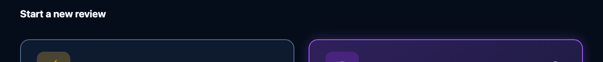
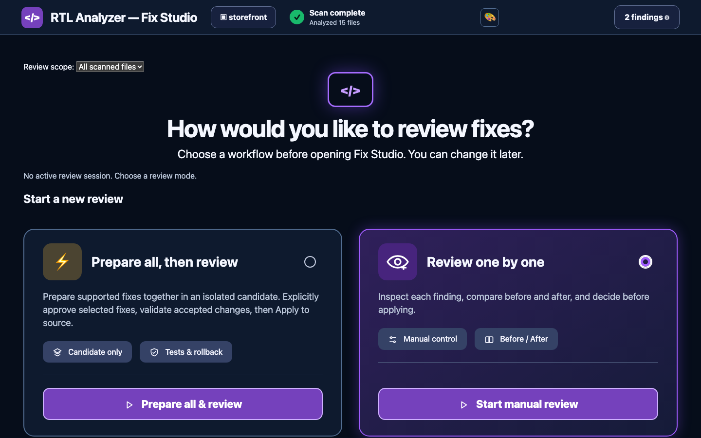
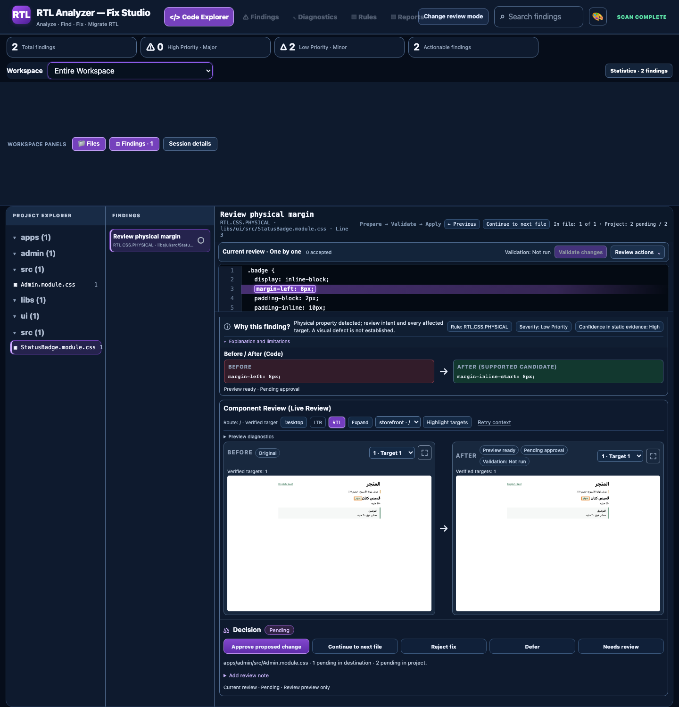
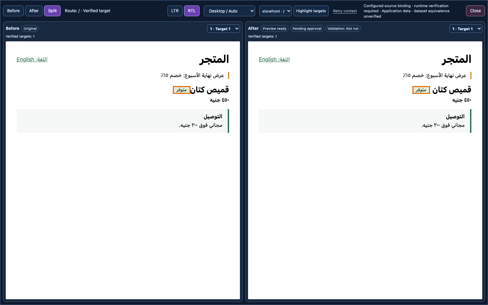
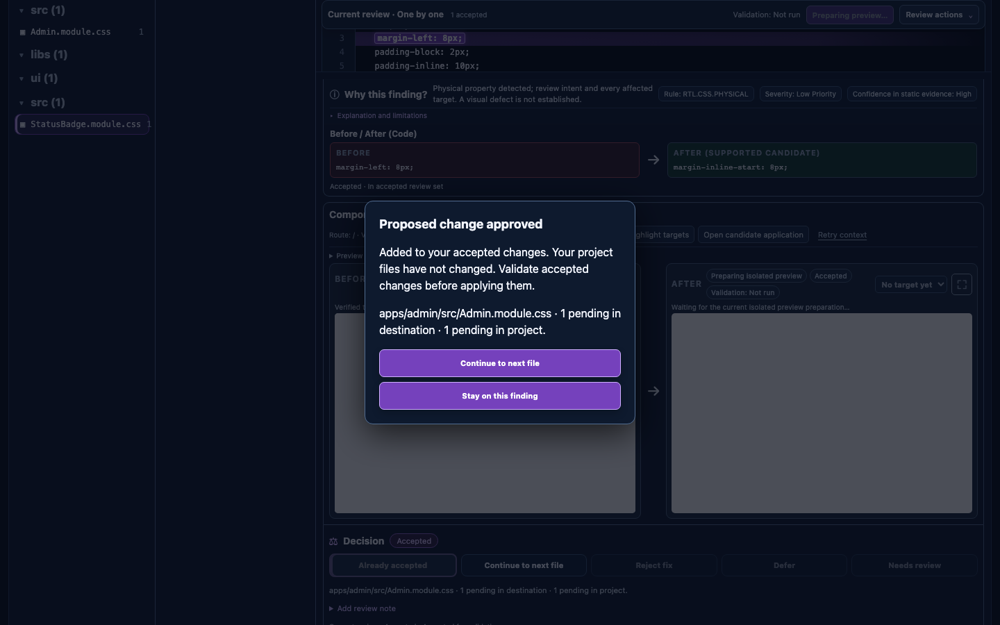
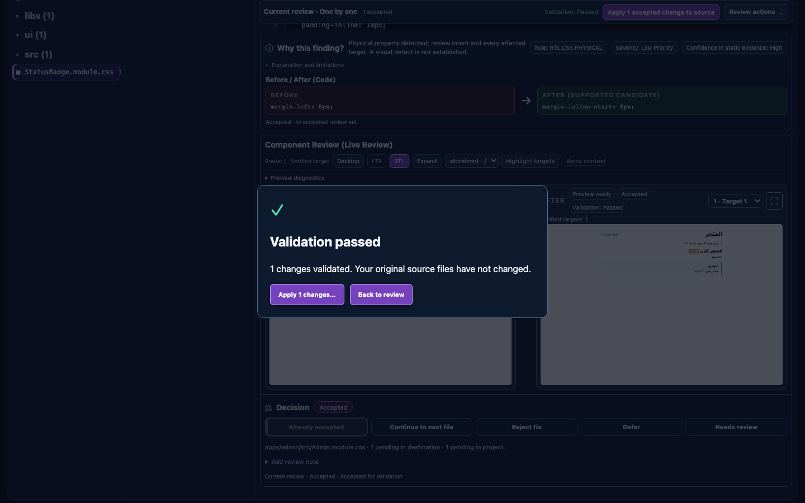
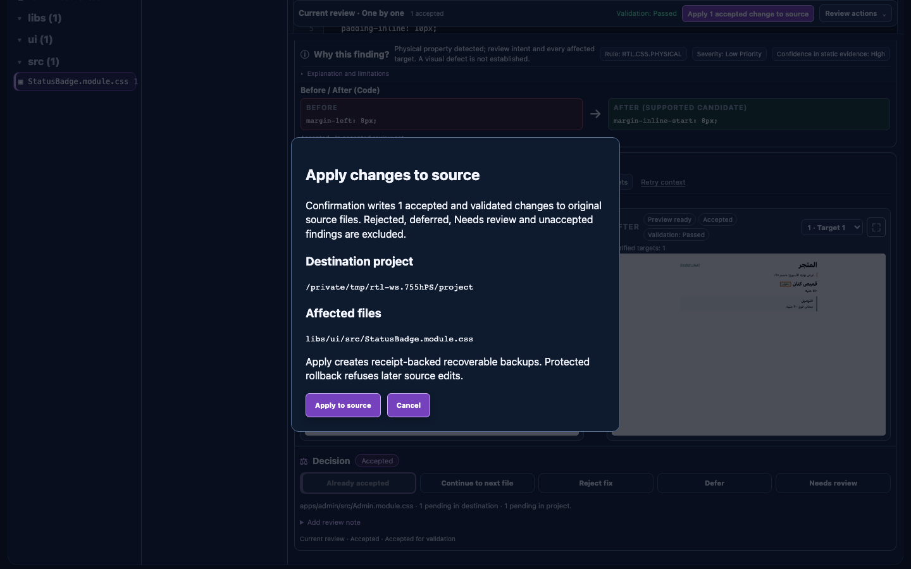
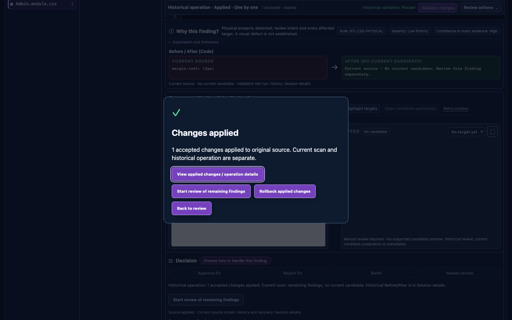
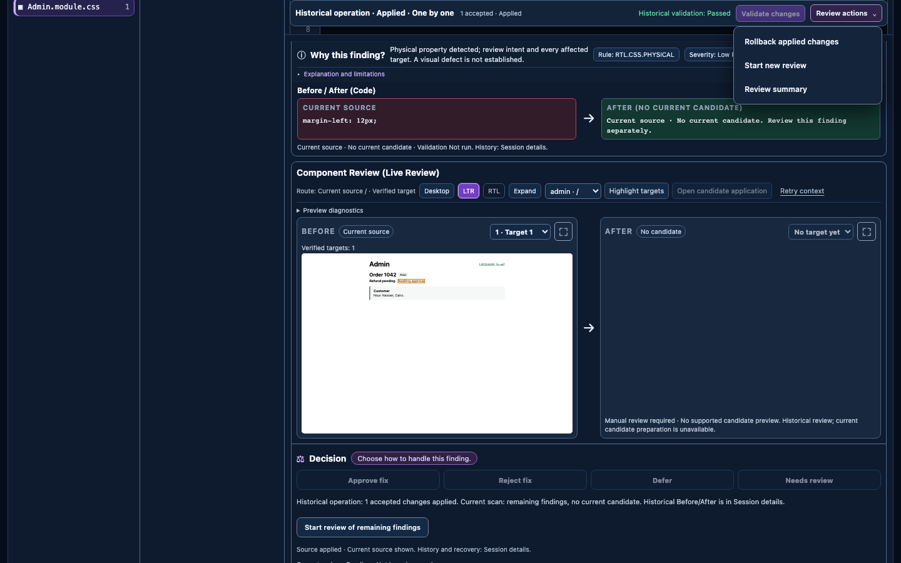
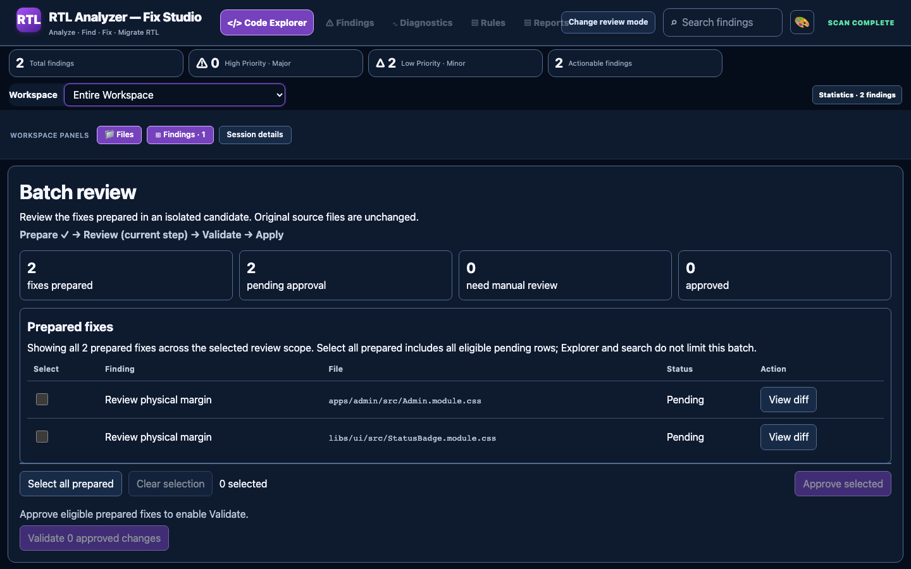

# RTL Analyzer

Find direction-dependent styles, inspect suggested fixes, and review changes for RTL and LTR interfaces.

[Quick start](#quick-start) · [Workflow](#how-a-review-works) · [Example projects](#example-projects) · [Limits](#what-is-and-is-not-covered) · [Advanced setup guide](https://github.com/FoushWare/rtl-analyzer/blob/main/docs/guides/developer-testing.md)

## Quick start

**Requirements:** Node.js 22.12 or later, on **macOS or Linux**. Windows is not supported in this release (see [what is and is not covered](#what-is-and-is-not-covered)).

Run from your frontend project's root:

```sh
npx rtl-analyzer
```

This scans the current directory, writes the reports to a temporary folder outside your project, and opens the dashboard in your browser. Your project files do not change unless you approve an Apply.

- **Dashboard:** the scan summary, the findings, and a shareable report.
- **Fix Studio:** open a finding to compare the original and the suggested change, then approve, validate, or roll back.
- **Live Before/After** starts your project's development server for you. This works for projects that ship a `rtl-preview.config.json` (see [Project scripts](#project-scripts)). Install the project's dependencies first; if they are missing, the dashboard says so and the static report stays available.

```sh
npm ci            # once, in your project (npm install, pnpm install, or yarn install also work)
npx rtl-analyzer
```

In an interactive terminal the dev server starts by default. In scripts and CI (no terminal), add `--approve-project-scripts`. To skip starting the dev server, run `npx rtl-analyzer --no-project-scripts`.

### Which version runs?

`npx rtl-analyzer` runs npm's **`latest`** tag, the current stable release. A project that already depends on `rtl-analyzer` uses its installed version instead.

| Command | Runs |
| --- | --- |
| `npx rtl-analyzer` | latest stable release (`latest`) |
| `npx rtl-analyzer@next` | latest prerelease, for testing (`next`) |
| `npx rtl-analyzer@<version>` | an exact version, for reproducible runs |

`latest` is the current stable release. To try a prerelease before it reaches `latest`, use `npx rtl-analyzer@next`.

### Project scripts

Live Before/After runs one script from your project, and only when `rtl-preview.config.json` names it under an application's `startupScript`. RTL Analyzer runs that script (for example `npm run dev`) in the project root, with `--host 127.0.0.1 --port <port> --strictPort`. It never runs other scripts or discovered commands, and it never installs packages or changes lockfiles.

**Security:** the script is your project's own code, the same code that `npm run dev` runs. Run `npx rtl-analyzer` only in projects you trust. Projects without `rtl-preview.config.json` never have a script run. To turn project scripts off, use `npx rtl-analyzer --no-project-scripts`; the static report is still produced. `--approve-project-scripts` is still accepted.

If dependencies are missing, the dashboard shows "Live Preview needs setup" with the project path and the install command for your package manager.

Scan one folder, or show help:

```sh
npx rtl-analyzer scan ./src --format json
npx rtl-analyzer --help
```

A read-only scan needs no configuration. **Live Fix Studio review does need configuration**: explicit scan and copy scope, validation scripts, source-to-page bindings, your project's installed dependencies, and Chromium. The [advanced setup guide](https://github.com/FoushWare/rtl-analyzer/blob/main/docs/guides/developer-testing.md) covers it. To try the whole flow first, use one of the [example projects](#example-projects).

## How a review works

The screenshots below come from an earlier release (0.4.0) running on the Workspace Integration example: a shared badge whose `margin-left: 8px` should follow the text direction. The dashboard layout in newer versions may differ slightly.

### 1. Run the scan and open Fix Studio

Scan with a dashboard report and embedded source snippets, serve the report, and start the review companion. The dashboard reports the scan result and the number of findings.



### 2. Choose a review mode

**Prepare all, then review** prepares every eligible change in one isolated candidate so you can review them together. **Review one by one** prepares only the finding you are looking at. Both modes start with every decision **Pending**, and neither changes your source.



### 3. Find the finding in your code and on the page

Each finding shows its highlighted source line and why it was flagged. For findings with a configured page binding, **Highlight targets** outlines the affected element in the running page.



### 4. Compare Before and After

The code card shows the original declaration next to the suggested one. The live panes render the original application (Before) and an isolated copy with the change (After). Switch between **LTR** and **RTL**, and between apps when a finding is bound to more than one. In one-by-one mode, After shows only the finding you selected.



### 5. Make a decision

Choose **Approve proposed change**, **Reject fix**, **Defer** or **Needs review**. Approving adds the change to your accepted set. Your project files still have not changed.



### 6. Validate the accepted changes

**Validate changes** runs your configured checks, and a scoped LTR/RTL runtime check, against a candidate that contains only the accepted changes.



### 7. Apply to source, explicitly

Applying is a separate step. The confirmation names the destination project and every file that will be written. Rejected, deferred and unaccepted findings are excluded, and Apply creates receipt-backed backups.



Afterwards, check your diff and the interface in both directions.



### 8. Roll back if needed

**Review actions → Rollback applied changes** restores the files from the receipt. Rollback is refused if you edited the files after Apply, so it never overwrites your later work.



### Batch mode: prepare eligible changes, then approve selected ones

In **Prepare all, then review**, the batch overview lists every change that could be prepared. Nothing is approved automatically. Select the rows you want, **Approve selected**, then **Validate** and apply as above. Preparing a batch never writes to your source; applying it requires the same explicit confirmation. Use **View diff** to inspect any row.



If your source or your decisions change during a review, freshness checks can invalidate a suggestion or a validation. Failed or unavailable required evidence blocks Apply.

## What is and is not covered

Verified on macOS with Chromium at desktop width for the 0.4.0 release:

- **Suggested fixes and live Before/After** for literal physical `margin-*`, `padding-*` and `text-align` in simple class rules of stylesheets you declare as `custom-css`, and for other declarations (borders, offsets, transforms) you declare yourself in `cssProposals` ([CSS proposal setup](https://github.com/FoushWare/rtl-analyzer/blob/main/docs/guides/css-proposal-setup.md)).
- **Findings without a safe automatic fix** (for example fixed-edge positioning, ordering, transforms) are reported with an explanation and marked for manual review; you still get the Before view.
- **Detection only:** recognized utility classes and bounded SCSS declarations.
- **Live preview** supports Vite-compatible development scripts, including an Nx workspace that runs Vite. Next.js apps can be scanned statically, but live preview is not supported.
- **Not detected:** JavaScript key handling, focus order and other behavior that is not expressed in styles.

A scan reports potential issues; it does not prove a page renders correctly. **Windows is not supported in v0.5.0.** The one-command dashboard and `--output-dir` report output are refused on Windows with `unsupported platform/filesystem profile` and exit code 2; nothing is written, and existing report files are left unchanged. Source snippets fail closed (`UNSUPPORTED_NOFOLLOW`) on Windows, so findings show as unavailable. Because the review workflow starts from the dashboard, it is not reachable through the packaged CLI on Windows in this release. Validation commands run only with npm on Windows; pnpm and yarn are refused. Windows support is planned for v0.6.0. Report publication and protected source operations use a trusted POSIX filesystem profile (macOS and Linux). Safari, package managers other than npm and general framework compatibility are not certified. Project scripts must be trusted.

## Example projects

Six runnable projects live in the repository under [`examples/`](https://github.com/FoushWare/rtl-analyzer/tree/main/examples). They are not part of the npm package. Copy one to a temporary folder before you apply anything.

| Project | What it shows |
| --- | --- |
| [Foundations Lab](https://github.com/FoushWare/rtl-analyzer/tree/main/examples/foundations-lab) | Direction, spacing, edges, transforms in a Vite app |
| [Account Checkout](https://github.com/FoushWare/rtl-analyzer/tree/main/examples/account-checkout) | Two supported fixes, one manual-review case, clean controls |
| [Admin Dashboard](https://github.com/FoushWare/rtl-analyzer/tree/main/examples/admin-dashboard) | Tables, dialog and tabs; several manual-review findings |
| [Bilingual Storefront](https://github.com/FoushWare/rtl-analyzer/tree/main/examples/bilingual-storefront) | Next.js and Tailwind; static scan only |
| [Interaction Playground](https://github.com/FoushWare/rtl-analyzer/tree/main/examples/interaction-playground) | Drawer, rating and slider; scanner finds CSS risks, not key handling |
| [Workspace Integration](https://github.com/FoushWare/rtl-analyzer/tree/main/examples/workspace-integration) | Nx workspace, two apps and a shared library |

Each project's README has its setup instructions and expected findings. The [hands-on testing guide](https://github.com/FoushWare/rtl-analyzer/blob/main/docs/guides/example-testing-guide.md) walks through all six.

## Development

The public package bundles a pinned implementation at build time. Consumers install `rtl-analyzer`; the internal `@atlas/rtl-scanner` package is private. Clone with submodules and follow the [build, pack and verification commands](https://github.com/FoushWare/rtl-analyzer/blob/main/docs/guides/developer-testing.md#build-pack-and-verify). Licensed under [MIT](https://github.com/FoushWare/rtl-analyzer/blob/main/packages/rtl-analyzer/LICENSE).
